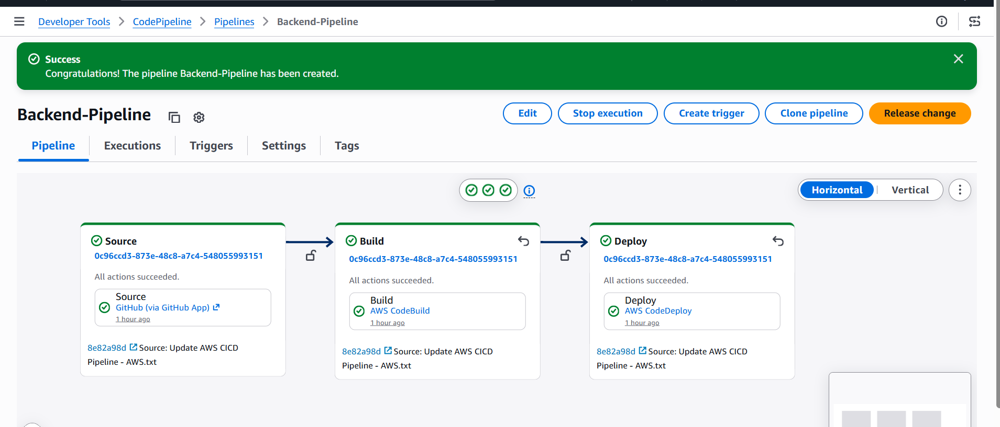

# AWS Three-Tier CI/CD DevOps Project


A cloud engineering project demonstrating the deployment of a three-tier web application on AWS, with automated build and deployment pipelines using AWS CodePipeline, CodeBuild, and CodeDeploy.

## Table of Contents

- [Project Overview](#project-overview)
- [Architecture](#architecture)
- [AWS Services](#aws-services)
- [Repository Structure](#repository-structure)
- [CI/CD Workflow](#cicd-workflow)
- [Deployment Steps](#deployment-steps)
- [Screenshots](#screenshots)
- [Security Best Practices](#security-best-practices)
- [Skills Demonstrated](#skills-demonstrated)
- [Author](#author)

## Project Overview

The objective of this project is to implement a scalable, multi-tier application architecture using AWS infrastructure and DevOps automation practices.

The architecture separates the web, application, and database layers to improve isolation, scalability, and maintainability.

The project includes dedicated CI/CD pipelines for the frontend and backend, enabling automated builds and deployments following changes to the source repository.

## Architecture


The infrastructure design includes:

- A custom Amazon VPC with public and private subnets across two Availability Zones.
- An external Application Load Balancer for incoming web traffic.
- NGINX web servers deployed in private subnets.
- An internal Application Load Balancer for application traffic.
- Node.js application servers.
- Amazon RDS for MySQL in private database subnets.
- Auto Scaling groups for web and application instances.
- Amazon S3 for build and deployment artifacts.

## AWS Services

| Service | Purpose |
|---|---|
| Amazon VPC | Network isolation and segmentation |
| Amazon EC2 | Web and application servers |
| Application Load Balancer | Traffic distribution |
| EC2 Auto Scaling | Automatic instance scaling |
| Amazon RDS for MySQL | Managed relational database |
| Amazon S3 | Artifact storage |
| AWS CodePipeline | CI/CD orchestration |
| AWS CodeBuild | Application builds |
| AWS CodeDeploy | Application deployment |
| AWS IAM | Identity and access management |
| AWS Systems Manager Parameter Store | Configuration and secret management |
| Amazon CloudWatch | Logs and monitoring |
| Amazon Route 53 | DNS management |
| AWS Certificate Manager | HTTPS certificates |

## Repository Structure

```text
AWS-Three-Tier-CICD-DevOps-Project/
├── backend/
├── frontend/
├── Screenshot/
├── app-tier-user-data.txt
├── web-tier-user-data.txt
├── Guide.txt
├── project-architecture.png
└── README.md
```

- `backend/`: Backend application and related CI/CD configuration.
- `frontend/`: Frontend application and build configuration.
- `Screenshot/`: Screenshots documenting the AWS setup and pipeline results.
- `app-tier-user-data.txt`: Bootstrap script for application instances.
- `web-tier-user-data.txt`: Bootstrap script for web instances.
- `Guide.txt`: Detailed deployment guide.
- `project-architecture.png`: Infrastructure architecture diagram.

## CI/CD Workflow

The project uses separate pipelines for the backend and frontend.

1. **Source:** GitHub provides the application source code.
2. **Build:** AWS CodeBuild executes the relevant build specification.
3. **Artifacts:** Build outputs are stored in an Amazon S3 artifact bucket.
4. **Deploy:** AWS CodeDeploy deploys application revisions to EC2 instances.
5. **Monitoring:** Amazon CloudWatch collects logs, while load balancer health checks help validate target availability.

### Pipeline Components

| Application tier | Build project | Deployment application |
|---|---|---|
| Backend | `backend-build` | `backend-deploy` |
| Frontend | `frontend-build` | `frontend-deploy` |

The actual resource names may vary according to your AWS configuration.

## Deployment Steps

Refer to [`Guide.txt`](Guide.txt) for detailed configuration instructions.

The main deployment phases are:

1. Create the VPC, subnets, routing tables, and Internet Gateway.
2. Configure security groups and IAM roles.
3. Deploy Amazon RDS for MySQL in private database subnets.
4. Configure EC2 launch templates and Auto Scaling groups.
5. Create external and internal Application Load Balancers.
6. Configure application parameters in Systems Manager Parameter Store.
7. Set up CodeBuild projects for the frontend and backend.
8. Configure CodeDeploy applications and deployment groups.
9. Create CodePipeline workflows connected to GitHub.
10. Configure HTTPS and Route 53 where applicable.
11. Validate target health, deployment results, application responses, and CloudWatch logs.

## Screenshots

Project evidence is available in the `Screenshot/` directory.

Examples include:

- Backend pipeline execution
- Frontend pipeline execution
- EC2 instances
- Amazon RDS configuration
- S3 build artifacts
- Application dashboard and sample results

To embed a screenshot, use its exact filename:

```md

```

## Security Best Practices

- Never publish AWS credentials, database passwords, access keys, or private keys.
- Store sensitive values in Parameter Store as `SecureString` or use AWS Secrets Manager.
- Apply least-privilege IAM permissions.
- Restrict SSH access and consider AWS Systems Manager Session Manager.
- Keep the database private and allow connections only from authorized application resources.
- Use HTTPS with a valid certificate for production deployments.
- Review user-data scripts, configuration files, and Git history before publishing the repository.
- Monitor AWS usage and remove lab resources when they are no longer required.

## Skills Demonstrated

- AWS networking and VPC design
- EC2, load balancing, and Auto Scaling
- Amazon RDS and database connectivity
- CI/CD automation with CodePipeline, CodeBuild, and CodeDeploy
- IAM security and access control
- Configuration management with Parameter Store
- CloudWatch logging and monitoring
- Technical documentation and cloud architecture

## Author

**Boubacar Djibrilla**

Junior Full-Stack Developer | AWS & DevOps

- GitHub: [@boubacardjibrilla](https://github.com/boubacardjibrilla)

---

*This project is intended for learning and portfolio demonstration. Review security, availability, and cost requirements before adapting the architecture for production.*
